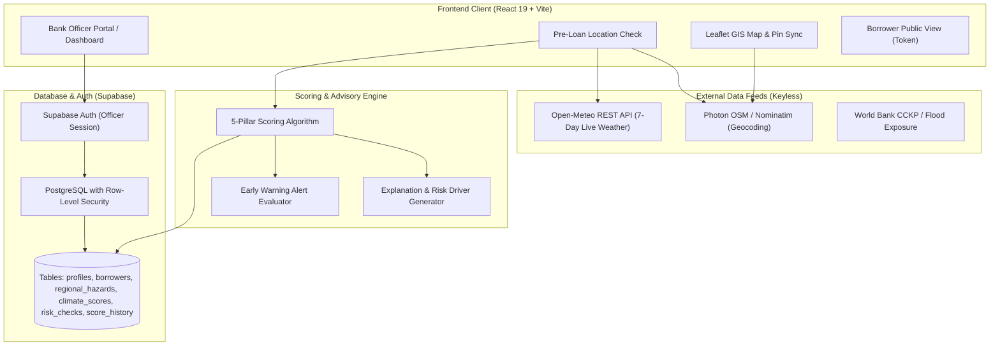

# OmniRisk — Climate Risk Scoring for MSME Lending
### Decision Support & Environmental Resilience Platform for Banks

[](https://vitejs.dev/)
[](https://react.dev/)
[](https://www.typescriptlang.org/)
[](https://tailwindcss.com/)
[](https://supabase.com/)

> **Smart India Hackathon 2026** | **Problem Statement:** FIN-05  
> **Team:** HyperNode  

---

## 1. Problem & Solution

### The Problem
Traditional MSME and agricultural credit underwriting evaluates past financial health (balance sheets, ITRs, repayment scores) while remaining blind to escalating acute climate risks (floods, unseasonal precipitation, prolonged drought, extreme heatwaves). When an unseasonal flood strikes an agro-processing cluster or a drought destroys rainfed crops, otherwise creditworthy borrowers face acute insolvency, driving non-performing assets (NPAs) across rural and semi-urban bank portfolios.

### The Solution
**OmniRisk** is a climate-risk assessment and decision-support engine engineered specifically for bank credit officers. By fusing historical climate hazard benchmarks (World Bank CCKP), live 7-day meteorological forecasts (Open-Meteo), and micro-level enterprise vulnerability factors (irrigation, soil resilience, grid reliability, supply chains), OmniRisk calculates an objective, transparent **0–100 Climate Resilience Score**. 

This empowers lenders to identify climate vulnerability before loan sanctioning, structure protective terms (parametric insurance, adaptive repayment schedules), and monitor portfolio-level climate hazards in real time.

---

## 2. Important Note: Advisory Mandate

> [!IMPORTANT]
> **OmniRisk is strictly an Advisory and Decision-Support Tool.**  
> It **never** approves, denies, or auto-rejects loans. The financing institution maintains 100% final lending authority. The platform contains zero automated underwriting denial logic; its sole purpose is to provide environmental intelligence and recommend protective resilience buffers.

---

## 3. Key Features

### Implemented & Verified Features (In Active Codebase)
- [x] **Bank-Only Authenticated Portal:** Role-based authentication (`bank_officer`) backed by Supabase Auth and Row-Level Security (RLS) ensuring strict multi-tenant bank isolation.
- [x] **Pre-Loan Location & Area Risk Check:** Standalone screening page (`/pre-loan-check`) enabling credit officers to evaluate prospective sites before onboarding. Supports forward geocoding (OpenStreetMap Photon), bidirectional map pin placement, dual-mode scoring ("Area-Only" baseline vs. "Area + Business" comprehensive), 200km regional hazard exposure intelligence, and audit logging to `risk_checks`.
- [x] **Customer Management (Full CRUD):** Complete customer directory with pagination, sector/district filters, and active vs. archived segmentation. Unified Add/Edit modal with real-time score preview, proximity duplicate detection (Haversine formula within 500m), soft-delete archiving with explicit confirmation, and automated score recalculation triggers with historical tracking in `score_history`.
- [x] **Transparent Climate Risk Scoring (0–100):** Objective 5-pillar mathematical engine delivering granular subscores, dynamic plain-English risk drivers ("Top 3 Primary Risk Drivers"), protective factors, and decoupled parametric insurance recommendations.
- [x] **Live Acute Weather Alerts:** Automatic hazard warning triggers comparing 7-day Open-Meteo precipitation and temperature forecasts against local district hazard baselines. Includes an alert center modal and a top critical hazard banner.
- [x] **Interactive GIS Risk Map & Portfolio View:** Leaflet map with custom animated risk-tiered pins, district-wise exposure aggregations, and sector vulnerability breakdowns.
- [x] **Borrower Self-Awareness View:** Public, token-secured portal (`/borrower/:token`) allowing borrowers to inspect their environmental resilience score gauge, understand risk drivers, and explore mitigation schemes without bank login credentials.
- [x] **Twin Borrower Paradox Demo:** Interactive comparative view (`/demo-twin`) demonstrating score divergence between two synthetic enterprises with identical financials (₹5L loan, ₹65k revenue, 740 credit score) operating in contrasting climate zones (flood-prone Kolhapur vs. drought-prone Pune).

### Planned Extensions
- [ ] Automated PDF summary report generation for credit committee dossiers.
- [ ] Custom GIS GeoJSON boundary shapefile imports for micro-watershed mapping.

---

## 4. Score Bands & Mathematical Model

OmniRisk scores represent **Climate Resilience on a 0–100 scale** (where **higher score = lower climate risk / higher resilience**):

| Score Band | Advisory Label | Institutional Guidance |
| :---: | :---: | :--- |
| **75 – 100** | **Low climate risk** | Robust environmental resilience; standard monitoring recommended. |
| **40 – 74** | **Moderate risk** | Moderate vulnerability; recommend insurance and seasonal monitoring. |
| **10 – 39** | **High risk** | High exposure; detailed review required; crop/asset insurance strongly recommended. |
| **0 – 9** | **Very high risk** | Critical vulnerability; flag for senior credit committee manual review. |

### Evidence Groups & Exact Weights (From `src/engine/factorWeights.ts`)

$$\text{Final Score} = (0.30 \times H) + (0.25 \times V) + (0.25 \times F) + (0.20 \times B) \pm S$$

1. **Regional Climate Hazard Exposure ($H$ — 30% weight):**  
   World Bank historical benchmarks for flood, drought, heat stress, and cyclone storm indices. Evaluated using the **Actuarial Peak-Peril Principle** ($65\%$ dominant acute hazard $+ 35\%$ secondary hazards average).
2. **Business & Farm Physical Vulnerability ($V$ — 25% weight):**  
   Micro-level operational resilience: soil retention capacity (e.g., Alluvial vs. Black/Clay), water security (e.g., Borewell + Drip vs. Rainfed), utility grid reliability, and supply chain proximity (e.g., direct APMC mandi vs. vulnerable logistics).
3. **Live 7-Day Weather Forecast ($F$ — 25% weight):**  
   Live meteorological data from Open-Meteo: forecast acute rainfall volume vs. local drainage thresholds, extreme heatwave degree deviations ($>40^\circ\text{C}$), and high wind gust exposure.
4. **Financial Resilience Buffer ($B$ — 20% weight):**  
   Enterprise debt service coverage ratio (monthly net revenue vs. loan EMI), historical repayment track record (scaled from 300–900), and active insurance buffers ($+20\text{ pts}$ cushion for active crop/property insurance).
5. **Bonus Modifier ($S$ — $\pm 5$ points):**  
   Remote-sensing vegetation health and moisture index proxy (NDVI/NDWI vegetative buffer).

---

## 5. Technology Stack & Architecture

### Core Technologies
- **Frontend Framework:** React 19 with Vite 8 (TypeScript)
- **Styling & Design System:** Tailwind CSS v3 with custom tokens (`primary: #00152a`, `secondary: #006a61`, `surface: #f7f9fc`, `error: #ba1a1a`) defined in `assets/DESIGN.md`
- **GIS & Mapping:** Leaflet & React-Leaflet with OpenStreetMap tiles (zero external API keys)
- **Icons & Visuals:** Google Material Symbols Outlined & Lucide Icons
- **Data Visualizations:** Recharts (7-day live weather forecasts, portfolio sector charts)
- **Database & Authentication:** Supabase (PostgreSQL 15+ with Row-Level Security, Supabase Auth)
- **Live Meteorological Feed:** Open-Meteo REST API (free, keyless high-resolution weather)
- **Geocoding & Location Search:** OpenStreetMap Photon API (CORS-enabled client autocomplete) & BigDataCloud client reverse geocoding

### System Architecture Diagram



---

## 6. Project Structure

```
Fusion 2026/
├── assets/                       # Visual design specifications and mockups
│   ├── DESIGN.md                 # Design token definitions, color palette, and typography
│   ├── code.html                 # Original mobile & web UI prototype specification
│   └── screen.png                # Reference dashboard screenshot
├── assests/                      # Aliased asset reference directory
├── public/                       # Static public web assets
├── scripts/                      # Automated verification and database utilities
│   ├── envHelper.mjs             # Environment variable loader for Node scripts
│   ├── createTestOfficer.mjs     # Script to provision synthetic bank officer
│   ├── generateSyntheticData.mjs # 26-borrower deterministic synthetic profile generator
│   ├── seedSupabase.mjs          # Seeds hazard benchmarks and synthetic borrowers
│   ├── testScoringEngine.mjs     # Unit test suite for scoring formula
│   ├── verifyEndToEnd.mjs        # End-to-end integration test runner
│   ├── verifyLocationSearch.mjs  # Automated verification for geocoding & map synchronization
│   └── verifyNewFeatures.mjs     # Phase G verification (CRUD, duplicate check, dual-mode)
├── src/
│   ├── api/                      # External API connectors and data services
│   │   ├── areaHazardService.ts  # Surrounding regional hazard intelligence (200km radius)
│   │   ├── customerService.ts    # Customer CRUD, duplication check, and soft-delete archive
│   │   ├── locationResolver.ts   # OpenStreetMap Photon geocoder & reverse geocoding
│   │   ├── openMeteo.ts          # Open-Meteo 7-day weather forecast client
│   │   ├── riskCheckService.ts   # Pre-loan check persistence and customer linking
│   │   ├── supabaseClient.ts     # Supabase client singleton with auth state helpers
│   │   └── worldBankHazards.ts   # Regional hazard benchmark service
│   ├── components/               # Modular UI component tree
│   │   ├── bank/                 # Bank officer dashboard components (BorrowerTable, CustomerFormModal, etc.)
│   │   ├── borrower/             # Public borrower view components (ScoreGauge, InsuranceAdvice, etc.)
│   │   └── common/               # Shared components (BankHeader, WeatherForecastWidget, etc.)
│   ├── data/                     # Seed benchmarks (worldBankHazards.json)
│   ├── engine/                   # Core climate scoring logic
│   │   ├── alertRules.ts         # Weather hazard threshold alert rules
│   │   ├── explanationGenerator.ts # Generates transparent human-readable explanations
│   │   ├── factorWeights.ts      # Configurable weighting matrix (30/25/25/20)
│   │   └── scoringEngine.ts      # Dual-mode and standard climate resilience calculation
│   ├── pages/                    # Routed application views
│   │   ├── BankDashboardPage.tsx # Officer command center with directory and risk map
│   │   ├── BankLoginPage.tsx     # Dedicated bank officer authentication page
│   │   ├── BorrowerAwarenessPage.tsx # Token-accessed public borrower awareness portal
│   │   ├── DemoTwinPage.tsx      # Side-by-side Twin Borrower Paradox demo
│   │   └── PreLoanRiskCheckPage.tsx # Pre-loan location screening and dual-mode check
│   ├── types/                    # TypeScript interfaces for database, weather, and scoring
│   ├── utils/                    # Formatting helpers and risk tier color resolvers
│   ├── App.tsx                   # Main application router with ProtectedRoute guards
│   ├── main.tsx                  # Application entry point
│   └── index.css                 # Global Tailwind stylesheet and Material Symbols imports
├── supabase/                     # PostgreSQL database definitions
│   ├── migrations/               # Schema migrations (customer archive, risk_checks)
│   ├── schema.sql                # Complete Supabase schema with RLS policies
│   └── seed.sql                  # Seed data for regional hazards and synthetic borrowers
├── .env.example                  # Sanitized environment variable template
├── .gitignore                    # Comprehensive git exclusion rules
├── package.json                  # Dependencies and build scripts
├── tsconfig.json                 # TypeScript compiler configuration
└── vite.config.ts                # Vite configuration with proxy and path aliases
```

---

## 7. Prerequisites & Installation

### Prerequisites
- **Node.js:** v18.0.0 or higher (v20+ recommended)
- **Package Manager:** npm (bundled with Node.js)
- **Supabase Account:** Free project on [supabase.com](https://supabase.com)

### Installation Steps

1. **Clone the repository:**
   ```bash
   git clone <repository-url>
   cd "Fusion 2026"
   ```

2. **Install project dependencies:**
   ```bash
   npm install
   ```

3. **Configure Environment Variables:**
   Copy the example template to create your local environment file:
   ```bash
   cp .env.example .env.local
   ```
   Open `.env.local` and enter your Supabase project credentials (see [Environment Variables](#8-environment-variables)).

4. **Start the local development server:**
   ```bash
   npm run dev
   ```
   The application will be live at `http://localhost:5173/`. To expose the dev server across your local Wi-Fi network, run `npm run host`.

5. **Run Verification & Test Suites:**
   ```bash
   # Run location search and geocoding test suite
   node scripts/verifyLocationSearch.mjs

   # Run customer management and dual-mode scoring tests
   node scripts/verifyNewFeatures.mjs

   # Run end-to-end integration test against Supabase
   node scripts/verifyEndToEnd.mjs
   ```

6. **Build for Production:**
   ```bash
   npm run build
   ```

---

## 8. Environment Variables

OmniRisk requires the following configuration keys:

| Variable Name | Description | Scope | Where to Obtain |
| :--- | :--- | :---: | :--- |
| `VITE_SUPABASE_URL` | Supabase Project REST / Auth API URL | **Public** (Frontend) | Supabase Dashboard $\rightarrow$ Project Settings $\rightarrow$ API $\rightarrow$ Project URL |
| `VITE_SUPABASE_ANON_KEY` | Supabase Anonymous Client Public API Key | **Public** (Frontend) | Supabase Dashboard $\rightarrow$ Project Settings $\rightarrow$ API $\rightarrow$ Project API Keys (`anon` / `public`) |
| `SUPABASE_SERVICE_ROLE_KEY` | Administrative service role key (bypasses RLS) | **Server-Only Secret** | Supabase Dashboard $\rightarrow$ Project Settings $\rightarrow$ API $\rightarrow$ Project API Keys (`service_role`) |

> [!CAUTION]
> `SUPABASE_SERVICE_ROLE_KEY` must **NEVER** be committed to source control or exposed in frontend code. It is reserved exclusively for offline database administrative scripts.

---

## 9. Supabase Database & Security Setup

1. **Create a Supabase Project:**
   Create a new project at [supabase.com](https://supabase.com).
2. **Execute Schema SQL:**
   Open the **SQL Editor** in your Supabase dashboard and run the contents of [supabase/schema.sql](file:///d:/Hackathon/Fusion%202026/supabase/schema.sql). This provisions the core tables (`profiles`, `regional_hazards`, `borrowers`, `climate_scores`, `climate_alerts`, `score_history`) and enables Row-Level Security (RLS).
3. **Apply Phase G Migrations:**
   Run the migration script [supabase/migrations/20261009_customer_and_risk_checks.sql](file:///d:/Hackathon/Fusion%202026/supabase/migrations/20261009_customer_and_risk_checks.sql) to add the `risk_checks` table, customer archive flags, and multi-tenant bank isolation policies.
4. **Seed Hazard Benchmarks & Synthetic Borrowers:**
   Run the automated seed script from your terminal:
   ```bash
   node scripts/createTestOfficer.mjs
   node scripts/seedSupabase.mjs
   ```

---

## 10. Data Sources

1. **Open-Meteo REST API:** Free, high-resolution global weather forecast service providing 7-day precipitation volume, daily maximum temperatures, and wind speed. Requires zero API keys.
2. **World Bank Climate Change Knowledge Portal (CCKP):** Regional historical climate risk indices for Indian districts, capturing chronic drought and heat stress frequency.
3. **World Bank Global Flood Exposure Dataset:** Baseline riverine and flash flood hazard benchmarks across target agricultural belts.
4. **Deterministic Synthetic Borrower Dataset:** All 26 demo borrower records are synthetically generated for demonstration purposes and tagged with `is_synthetic = true`. No real customer, farmer, or banking data is contained in this repository.

---

## 11. Demo Guide: Step-by-Step Walkthrough

1. **Sign In to Bank Command Center:**
   - Navigate to `http://localhost:5173/login`.
   - Click the **"Quick Demo Fill (Lead Risk Officer)"** button to populate synthetic credentials:
     - **Email:** `officer@omnirisk.com`
     - **Password:** `BankOfficer2026!`
   - Click **"Access Command Center"**.
2. **Explore Portfolio Risk & GIS Map:**
   - Review top portfolio KPIs (Average Climate Resilience, High-Risk Exposure, Acute Alerts).
   - Filter the Customer Directory by district (e.g., *Kolhapur*, *Pune*) or sector (*Agriculture*, *Food Processing*).
   - Click any pin on the Leaflet GIS Map to inspect enterprise micro-hazards.
3. **Test Pre-Loan Location Risk Check:**
   - Click **"Pre-Loan Check"** in the top navigation.
   - Search for an Indian location in the search bar (e.g., `Shirol` or `Baramati`).
   - Notice the map viewport smoothly animate via `flyTo` and center the marker at the exact coordinates.
   - Click **"Evaluate Risk & Hazard Exposure"** to trigger dual-mode assessment against live Open-Meteo forecasts and World Bank indices.
4. **Register a New Enterprise:**
   - In the dashboard, click **"Add New Customer"**.
   - Switch to Tab 2 ("Location & GIS"), search a location, and verify coordinate population.
   - Observe the live score preview adjust in real time as resilience attributes are modified.
5. **Inspect the Twin Borrower Paradox:**
   - Navigate to `/demo-twin` via the top navigation banner.
   - Observe two synthetic borrowers with identical financials (₹5,00,000 loan, ₹65,000 revenue, 740 credit score).
   - See how **Kaveri Agro** (Kolhapur flood plain) receives an advisory score of **28/100 (High Risk)** while **Sahyadri Bio-Farms** (Pune elevated tableland) receives **82/100 (Low Risk)** strictly due to environmental hazard exposure.

---

## 12. Security Notes

- **Git Exclusions:** The root `.gitignore` excludes all `.env*` files, local certificates, keys, debug logs, and Supabase local files.
- **Client Key Security:** The `VITE_SUPABASE_ANON_KEY` is a client-safe key intended for browser operations. All database tables strictly enforce PostgreSQL Row-Level Security (RLS) policies based on the authenticated officer's institutional identity (`bank_name`).
- **Secret Hygiene:** Never commit `SUPABASE_SERVICE_ROLE_KEY` or any private service token.

---

## 13. Limitations & Disclaimers

1. **Advisory Decision-Support Only:** OmniRisk does not underwrite, approve, or reject loan applications. Final lending decisions remain the sole responsibility of the bank credit committee.
2. **Prototype Weighting Matrix:** Factor weights (30% Hazard, 25% Vulnerability, 25% Forecast, 20% Financial) are established based on institutional climate risk literature and actuarial peak-peril principles, but have not yet been backtested against proprietary historical bank default datasets.
3. **Demonstration Dataset:** All borrower names, contact numbers, and enterprise profiles are purely synthetic.

---

## 14. Project Metadata & Team

- **Hackathon:** Smart India Hackathon 2026
- **Problem Statement:** FIN-05
- **Team Name:** HyperNode
- **Product Name:** OmniRisk (Decision Support System for Banks)

---

## 15. License

Placeholder: Distributed under the MIT License for Smart India Hackathon 2026 demonstration. See `LICENSE` for details.
