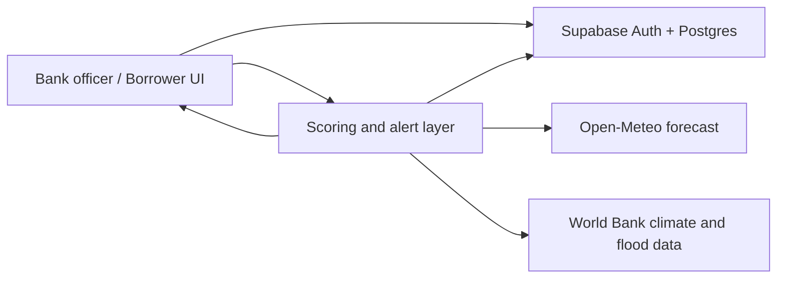

# OmniRisk

**Climate risk scoring for MSME and farm lending: decision support for banks.**

OmniRisk gives bank officers a live, explainable **Climate Risk Score (0–100)** for each borrower, so they can see how floods, storms, drought and heat may affect a business **before** a loan is given, and keep watching that risk afterwards.

> **OmniRisk is advisory only.** It never approves or rejects a loan. The bank makes every lending decision.

Built by team **HyperNode** for **Fusion 2026**, Problem Statement **FIN-05: Real-Time Climate Risk Scoring for MSMEs** (International Finance Corporation).

---

## Table of contents

1. [The problem](#the-problem)
2. [The solution](#the-solution)
3. [Features](#features)
4. [How the score works](#how-the-score-works)
5. [Tech stack](#tech-stack)
6. [Architecture](#architecture)
7. [Project structure](#project-structure)
8. [Getting started](#getting-started)
9. [Environment variables](#environment-variables)
10. [Supabase setup](#supabase-setup)
11. [Demo guide](#demo-guide)
12. [Data sources](#data-sources)
13. [Security and privacy](#security-and-privacy)
14. [Limitations](#limitations)
15. [Team](#team)

---

## The problem

Two small businesses can have the same income, loan size and repayment history, yet face very different climate risk. Floods can damage assets, heat and drought can cut output, and disrupted roads, power or water can delay recovery. Traditional credit files show finances, not climate exposure, and they are static snapshots that miss fast-changing weather risk.

## The solution

OmniRisk combines four kinds of evidence into one score and explains the reasons behind it:

- **Location hazard:** flood, storm, drought and heat exposure for the area
- **Business vulnerability:** business or crop type, soil, irrigation, power and water reliability, market access
- **Forecast risk:** the next 7 days of rainfall, temperature and extreme-weather signals
- **Financial resilience:** income, loan size, repayment history, insurance status

Officers see the score, the top drivers, a risk map and forecast-based alerts. Borrowers get a simple awareness view of their own risk.

## Features

Build status for each feature is tracked in [`PLAN.md`](./PLAN.md).

- **Bank-only login:** a dedicated login page backed by Supabase Auth, with protected dashboard routes
- **Customer management:** add, edit and delete (archive) customers, with search and filters
- **Pre-loan location and area risk check:** check a prospective customer's location and surrounding area *before* lending, even if they are not yet saved as a customer
- **Climate Risk Score (0–100):** transparent weighted formula with a breakdown across the four evidence groups
- **Explained drivers:** plain-language reasons beside every score, for example "high flood exposure; good irrigation access"
- **Live forecast alerts:** 7-day weather signals flag emerging risk for the bank's portfolio
- **Risk map and portfolio view:** borrowers colored by risk level, with district summaries
- **Borrower awareness view:** a simple score explanation with insurance and preparedness suggestions

## How the score works

Lower score = greater climate-related risk.

| Score | Band | Suggested advisory action |
|---|---|---|
| 75–100 | Low | Routine monitoring |
| 40–74 | Moderate | Insurance review, closer monitoring |
| 10–39 | High | Detailed review suggested |
| 0–9 | Very high | Careful manual review |

Initial prototype weights (check the scoring module in the code for the values in use):

| Evidence group | Weight |
|---|---|
| Location hazard | 30% |
| Business vulnerability | 25% |
| Forecast risk | 25% |
| Financial resilience | 20% |

The bands and weights are advisory labels for the prototype. They are **not** validated probabilities of default and should be calibrated on real loan-performance data before any production use.

When some inputs are missing (for example in a quick pre-loan area check), the result is labelled **Area-only** instead of **Area + business**, and the unavailable evidence groups are shown as unavailable rather than assumed.

## Tech stack

| Layer | Technology |
|---|---|
| Database and authentication | Supabase (Postgres, Auth, row-level security) |
| Frontend | `<!-- TODO: fill in framework chosen in the project -->`; static assets live in the `assets/` folder |
| Scoring and alerts | `<!-- TODO: fill in language/runtime chosen in the project -->` |
| Maps | `<!-- TODO: e.g. Leaflet, if used -->` |
| Weather and climate data | Open-Meteo, World Bank Climate Change Knowledge Portal, World Bank Global Flood Exposure |

## Architecture



1. The officer signs in through the bank-only login.
2. The UI reads and writes customers, scores, alerts and check history in Supabase.
3. The scoring layer maps a location to hazard data, adds the 7-day forecast, builds the score and its explanations, and returns them to the UI.
4. The alert rules flag borrowers when forecast and exposure signals combine (for example, heavy rain forecast in a high flood-exposure area).

## Project structure

`<!-- TODO: replace with the real folder tree once finalized -->`

```
.
├── assets/        # Images, icons and other frontend assets
├── PLAN.md        # Build plan and progress checklist
├── README.md
├── .env.example   # Variable names only, no secrets
└── .gitignore
```

## Getting started

### Prerequisites

- A Supabase project (free tier is enough)
- `<!-- TODO: runtime/version, e.g. Node or Python version -->`
- Git

### Install and run

```bash
# 1. Clone the repository
git clone <your-repository-url>
cd omnirisk

# 2. Create your local environment file
cp .env.example .env
# then open .env and fill in your own values (never commit this file)

# 3. Install dependencies
# TODO: add the install command used by this project

# 4. Run the app
# TODO: add the start command used by this project
```

## Environment variables

Copy `.env.example` to `.env` and fill in your own values. The exact variable names come from the code; the table below shows the typical set.

| Variable (typical name) | Purpose | Visibility |
|---|---|---|
| Supabase project URL | Connects the app to your Supabase project | Public |
| Supabase anon (public) key | Client access, limited by row-level security | Public |
| Supabase service role key | Full database access for trusted server code only | **Secret, server only** |
| Any other API keys | Only if a data provider requires one | **Secret** |

Open-Meteo's public forecast API does not need a key for basic use.

Never commit `.env`, and never expose the service role key in frontend code.

## Supabase setup

1. Create a new project at [supabase.com](https://supabase.com).
2. Copy the project URL and keys into your `.env` file.
3. Apply the database schema and migrations from the repository (see the migrations/SQL folder referenced in `PLAN.md`).
4. Enable **row-level security** on every table, so each bank can only see its own customers, scores, alerts and check history.
5. In **Authentication**, create the bank officer accounts you need for testing. There is no public sign-up for borrowers or the public.
6. Optional: load the synthetic seed data for the demo.

## Demo guide

All demo borrower profiles are **synthetic** and labelled as such in the app.

1. Sign in on the bank login page.
2. Open **Pre-Loan Risk Check**, enter a flood-prone location and a safer location, and compare the results (score, band, breakdown, forecast, map).
3. Save the riskier location as a new customer.
4. Edit the customer's irrigation or insurance status and watch the score update, with the old score kept in history.
5. Open the dashboard to see the risk map, district summary and forecast alerts.
6. Open the borrower view to see the plain-language explanation and suggestions.

Throughout, note that OmniRisk shows risk labels and suggested actions only, never "approved" or "rejected".

## Data sources

- [Open-Meteo](https://open-meteo.com/): weather forecasts
- [World Bank Climate Change Knowledge Portal](https://climateknowledgeportal.worldbank.org/): historical climate and hazard data
- [World Bank Global Flood Exposure](https://datacatalog.worldbank.org/search/dataset/0062763/global-flood-exposure-gridded-exposure-headcounts-bycountry): gridded flood exposure
- Borrower records in the demo are **synthetic**

## Security and privacy

- Environment variables, API keys, certificates and confidential data are excluded by `.gitignore`. Only `.env.example` (names, no values) is committed.
- Access is limited to authenticated bank officers and enforced by Supabase row-level security, not only by the UI.
- The Supabase service role key is used only in trusted server code.
- Handle borrower data in line with India's Digital Personal Data Protection Act. Use only synthetic data for demos.
- If a key is ever committed by mistake, rotate it immediately.

## Limitations

- Scores are advisory and based on initial weights that are not yet calibrated on real loan-performance data.
- Public hazard datasets have limited resolution and coverage, and forecasts can be wrong. Missing data is shown as unavailable, never as zero.
- Demo data is synthetic and does not represent real borrowers.
- The tool supports, and does not replace, a bank's own credit assessment.

## Team

**HyperNode**: Fusion 2026, Problem Statement FIN-05 (International Finance Corporation).

## License

`<!-- TODO: choose a license, e.g. MIT, or state "All rights reserved" -->`
